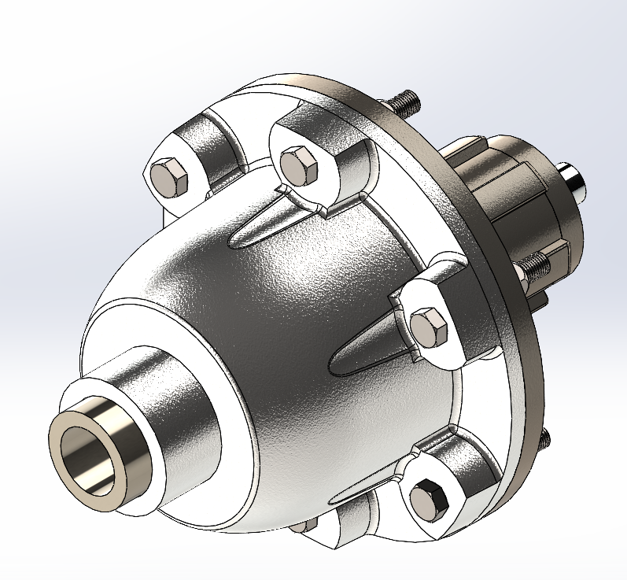
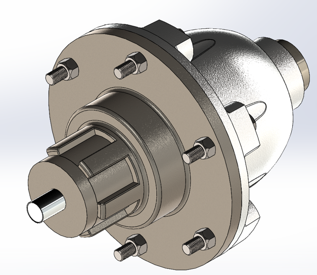
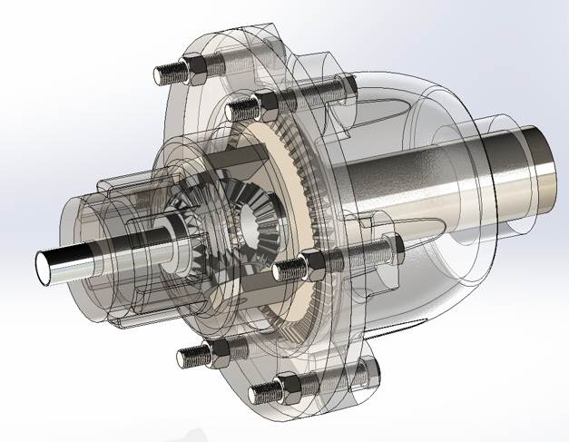
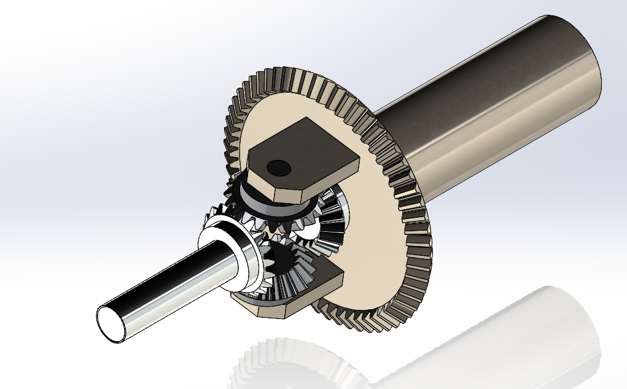
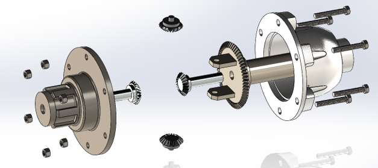
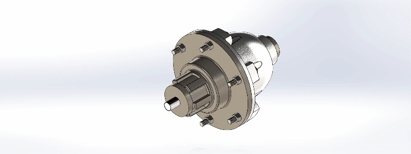
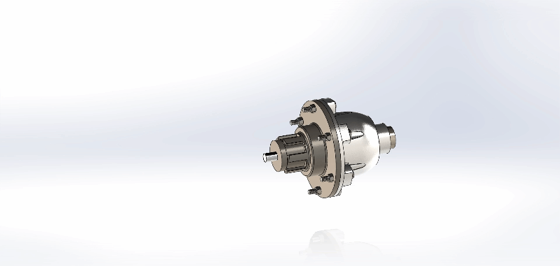

# Differential Gear Assembly: Bevel Gear Differential with Housing

SolidWorks model of a bevel-gear differential: ring gear mounted on a carrier, spider and side gears, two output shafts, a splined hub with flange plate and a ribbed housing, bolted together with a six-bolt flange.

<p align="center">
  
</p>

> Built as a skill-building project to practise gear modelling, assembly design and exploded views in SolidWorks. I started from the gear layout of a public tutorial video. That reference model did not assemble correctly, so I reworked it: I removed an unnecessary gear, corrected the tooth meshing of a gear pair and designed the cover myself. No strength or performance calculations were performed, so the dimensions are not intended for manufacturing.

## Highlights

- **Bevel gear differential** with ring gear, carrier, spider gears and side gears
- **Standard gear parameters** (module 5, 20° pressure angle) shared across the gear set
- **Ring gear integrated with the carrier** through shaft slots, cut-outs and connection holes
- **Ribbed housing** with a six-bolt flange and a splined hub plate
- **Exploded view and animations** that show how the parts fit together

## Views

<p align="center">
  
  
</p>

## Inside the differential

<p align="center">
  
  
</p>

## Exploded view

<p align="center">
  
</p>

## Animations

  





## How a differential works

The ring gear drives the carrier. The spider gears mounted on the carrier mesh with the two side gears, which are connected to the output shafts. When both shafts turn at the same speed the spider gears simply travel with the carrier; when one shaft is slowed down, the spider gears rotate and let the other shaft turn faster, while the torque stays split equally between the two outputs.

In this model the ring gear is the input element. The drive pinion that would normally turn it is not modelled.

## Components

| Part | Qty | Description |
|---|---|---|
| Housing | 1 | Bell-shaped casing with stiffening ribs, mounting flange and output shaft boss |
| Flange plate with splined hub | 1 | Closes the housing and carries the hub |
| Carrier | 1 | Holds the ring gear and the spider gears |
| Ring gear (G60) | 1 | Large bevel gear fixed to the carrier |
| Spider and side gears (G20) | 4 | Two spider gears and two side gears |
| Output shafts | 2 | One on each side |
| Hex bolts and nuts | 6 + 6 | Six-bolt flange |

## Gear data

| Name | Role | Module | Teeth | Pressure angle | Face width | Pitch diameter |
|---|---|---|---|---|---|---|
| G20 | Spider and side gears | 5 mm | 20 | 20° | 25 mm | 100 mm |
| G60 | Ring gear (bevel) | 5 mm | 60 | 20° | 40 mm | 300 mm |

Pitch diameter = module × number of teeth.

## Design approach

- The gear set uses a common module of 5 mm and a 20° pressure angle.
- Compared with the reference setup, I removed an extra gear, fixed the meshing of a gear pair that did not engage, and designed the flange and rear cover myself.
- The ring gear was extended with shaft slots, cut-outs and shaft connection holes to integrate it with the carrier and housing.
- The exploded view documents the assembly order and shows how every part fits.

## Repository structure

```
differential-gear-assembly/
├── cad/        SolidWorks parts and assembly (.SLDPRT / .SLDASM)
├── step/       Neutral CAD format (.step), opens in any CAD software
├── images/     Renders, transparent and exploded views
└── media/      Animations
```

## How to open the files

- **SolidWorks:** open the assembly file in `cad/`. All parts are in the same folder, so keep them together.
- **No SolidWorks?** Open the `.step` files in a free viewer such as eDrawings, FreeCAD or Autodesk Fusion.
- **Quick look:** the images in `images/` and the animations in `media/` need no software.

## Possible next steps

- Add a drive pinion and verify the speed relation with a motion study
- Check the contact stresses on the bevel gears with a simple FEA
- Add technical drawings with tolerances

## Tools

SolidWorks (part, assembly, exploded view, animation) and SolidWorks Toolbox.

## Contact

**Yusuf Berk Say**, Mechanical Engineer, Istanbul

- LinkedIn: [Yusuf Berk Say](https://www.linkedin.com/in/yusuf-berk-say-9bb68a234/)
- Email: yusufberk.say0@gmail.com
